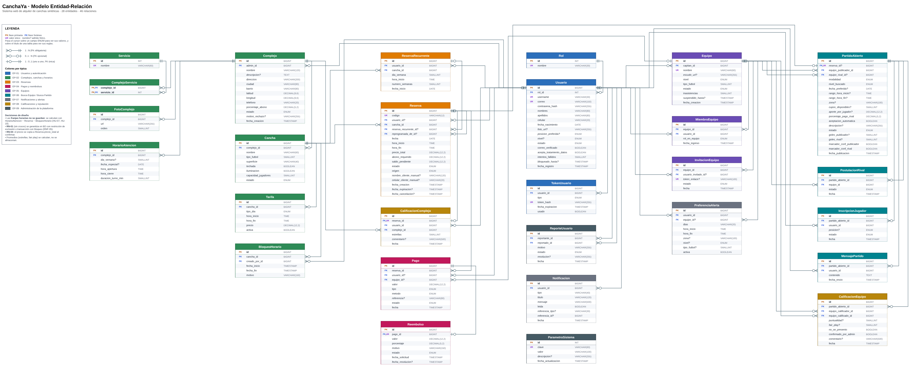

# CanchaYa
 
**Sistema web de alquiler de canchas sintéticas.** Permite reservar una cancha específica por horario, pagar un abono en línea y, además, encontrar rival o jugadores faltantes para que ninguna reserva se pierda.
 
> Proyecto de la materia **Desarrollo de Software 2** · Metodología ágil (Scrum) · Versión 1.1 (20 de octubre de 2026)
 
## Contenido
 
1. [Integrantes](#1-integrantes)
2. [Idea de desarrollo web](#2-idea-de-desarrollo-web)
3. [Requerimientos funcionales (Historias de usuario - Épicas)](#3-requerimientos-funcionales-historias-de-usuario---épicas)
4. [Requerimientos no funcionales (Definition of Done)](#4-requerimientos-no-funcionales-definition-of-done)
5. [Requerimientos técnicos (Historias técnicas)](#5-requerimientos-técnicos-historias-técnicas)
6. [Modelado de la base de datos (Diagrama Entidad-Relación)](#6-modelado-de-la-base-de-datos-diagrama-entidad-relación)
7. [Estructura del repositorio](#7-estructura-del-repositorio)
8. [Instalación y ejecución](#8-instalación-y-ejecución)
9. [Licencia](#9-licencia)
---
 
## 1. Integrantes
 
| Integrante |
|---|
| Jacobo Arenas |
| Michael Steven |
| Mera Ruiz |
| Ivan |
 
---
 
## 2. Idea de desarrollo web
 
**CanchaYa** es una aplicación web para reservar canchas sintéticas por horario y por cancha específica. Además conecta equipos incompletos mediante el módulo **"Busca Equipo / Busca Partido"**.
 
### Problema
 
- Los complejos deportivos administran las reservas por WhatsApp o en cuaderno, lo que genera **cruces de horario, cancelaciones de última hora y canchas vacías**.
- Muchos grupos solo reúnen 5 jugadores y **no pueden completar un partido** de fútbol 5 contra 5.
### Objetivo general
 
Desarrollar una plataforma web que permita a los complejos deportivos administrar sus canchas, horarios y reservas, y a los jugadores reservar en línea y encontrar rivales o jugadores faltantes para completar sus partidos.
 
### Objetivos específicos
 
1. Permitir la gestión de complejos (sedes), canchas, tarifas y horarios de atención.
2. Ofrecer reservas en línea con disponibilidad en tiempo real, evitando cruces de horario.
3. Implementar el módulo Busca Equipo / Busca Partido para emparejar equipos incompletos o sin rival.
4. Gestionar pagos de abono y saldo, cancelaciones y políticas de reembolso.
5. Entregar reportes de ocupación e ingresos al administrador del complejo.
### Alcance
 
| Incluye | Queda fuera de esta versión |
|---|---|
| Registro de usuarios y autenticación | App móvil nativa |
| Gestión de complejos, canchas, horarios y tarifas | Torneos completos con fixture |
| Reservas (con retención de franja y cancelación) | Pasarela de pagos real (se simula y queda preparada para integrarla) |
| Pagos (registro de abonos) y reembolsos | |
| Equipos y módulo Busca Partido | |
| Notificaciones, calificaciones y reportes | |
 
### Roles del sistema
 
Un mismo usuario puede ser jugador y capitán a la vez.
 
| Rol | Qué puede hacer |
|---|---|
| **Visitante** | Ver complejos, canchas, tarifas y disponibilidad, y registrarse. |
| **Jugador** | Reservar, pagar, cancelar, unirse a equipos y partidos abiertos, y calificar. |
| **Capitán de equipo** | Crear y administrar un equipo, invitar o expulsar miembros, publicar en Busca Partido y aceptar rivales. |
| **Administrador del complejo** | Gestionar canchas, horarios, tarifas, reservas, pagos, bloqueos y reportes de su sede. |
| **Superadministrador** | Aprobar complejos, gestionar usuarios, moderar reportes y configurar parámetros globales. |
 
### Módulo "Busca Equipo / Busca Partido"
 
Resuelve el problema principal del proyecto y funciona en dos modalidades:
 
- **Busco rival:** un equipo completo busca otro equipo para jugar.
- **Faltan jugadores:** un equipo incompleto busca jugadores sueltos.
### Tecnologías sugeridas (no claras todavia)
 
| Capa | Tecnología |
|---|---|
| Frontend | React |
| Backend | Node.js con Express (o Java con Spring Boot) |
| Base de datos | PostgreSQL o MySQL |
| Despliegue | Docker y GitHub Actions |
 
---
 
## 3. Requerimientos funcionales (Historias de usuario - Épicas)
 
**Convenciones:** las historias siguen el formato *Como [rol] quiero [acción] para [beneficio]*, con criterios de aceptación en formato Dado / Cuando / Entonces. Prioridad MoSCoW: **Alta** = Must, **Media** = Should, **Baja** = Could. Estimación en puntos de historia (escala Fibonacci).
 
### 3.1 Épicas
 
| Código | Épica | Historias | Prioridad |
|---|---|---|---|
| EP-01 | Usuarios y autenticación | HU-01 a HU-04 | Alta |
| EP-02 | Complejos, canchas y horarios | HU-05 a HU-09 | Alta |
| EP-03 | Reservas | HU-10 a HU-15 | Alta |
| EP-04 | Pagos y cancelaciones | HU-16 a HU-18 | Alta |
| EP-05 | Equipos | HU-19 a HU-21 | Alta |
| EP-06 | Busca Equipo / Busca Partido | HU-22 a HU-27 | Alta |
| EP-07 | Notificaciones | HU-28 a HU-29 | Media |
| EP-08 | Calificaciones y reputación | HU-30 a HU-31 | Media |
| EP-09 | Reportes y administración de la plataforma | HU-32 a HU-33 | Media |
 
### 3.2 Historias de usuario
 
#### EP-01 · Usuarios y autenticación
 
| Código | Historia | Prioridad | Pts | Sprint |
|---|---|---|---|---|
| HU-01 | **Registro de usuario.** Como visitante quiero crear una cuenta con mis datos para poder reservar canchas y unirme a partidos. | Alta | 3 | 1 |
| HU-02 | **Inicio y cierre de sesión.** Como usuario registrado quiero iniciar sesión con correo y contraseña para acceder a mis reservas y equipos. | Alta | 2 | 1 |
| HU-03 | **Recuperar contraseña.** Como usuario quiero restablecer mi contraseña por correo para recuperar el acceso si la olvido. | Media | 2 | 1 |
| HU-04 | **Perfil de jugador.** Como jugador quiero completar mi perfil con foto, posición preferida y nivel de juego para que otros equipos sepan cómo juego cuando me una a un partido. | Media | 3 | 1 |
 
#### EP-02 · Complejos, canchas y horarios
 
| Código | Historia | Prioridad | Pts | Sprint |
|---|---|---|---|---|
| HU-05 | **Registrar complejo deportivo.** Como administrador del complejo quiero registrar mi sede con nombre, dirección, ciudad, teléfono, fotos y servicios para publicarla en la plataforma. | Alta | 3 | 1 |
| HU-06 | **Registrar canchas.** Como administrador del complejo quiero registrar cada cancha de mi sede con su tipo y características para que los jugadores elijan en cuál jugar. | Alta | 3 | 1 |
| HU-07 | **Configurar horarios de atención.** Como administrador del complejo quiero definir los días y horas de apertura y la duración de cada turno para que el sistema genere las franjas reservables. | Alta | 5 | 1 |
| HU-08 | **Definir tarifas.** Como administrador del complejo quiero fijar precios por cancha según día y franja horaria para cobrar distinto en horas pico. | Alta | 3 | 1 |
| HU-09 | **Bloquear horarios.** Como administrador del complejo quiero bloquear una cancha en ciertas fechas y horas para hacer mantenimiento o eventos privados. | Media | 2 | 1 |
 
#### EP-03 · Reservas
 
| Código | Historia | Prioridad | Pts | Sprint |
|---|---|---|---|---|
| HU-10 | **Consultar disponibilidad.** Como jugador quiero buscar canchas disponibles filtrando por fecha, hora, tipo de cancha y ubicación para encontrar rápido dónde jugar. | Alta | 5 | 2 |
| HU-11 | **Reservar una cancha.** Como jugador quiero reservar una cancha específica en una franja horaria para asegurar mi espacio de juego. | Alta | 8 | 2 |
| HU-12 | **Cancelar o reprogramar reserva.** Como jugador quiero cancelar o mover mi reserva a otra franja para no perder mi dinero si surge un imprevisto. | Alta | 5 | 2 |
| HU-13 | **Ver mis reservas.** Como jugador quiero ver mis reservas próximas e historial para llevar control de mis partidos y pagos. | Media | 2 | 2 |
| HU-14 | **Gestionar reservas del complejo.** Como administrador del complejo quiero ver el calendario de todas mis canchas y crear reservas manuales para registrar a clientes que reservan por teléfono o en persona. | Alta | 5 | 2 |
| HU-15 | **Reserva recurrente (cancha fija).** Como jugador quiero reservar la misma cancha y franja cada semana para asegurar el partido fijo de mi grupo. | Baja | 5 | 5 |
 
#### EP-04 · Pagos y cancelaciones
 
| Código | Historia | Prioridad | Pts | Sprint |
|---|---|---|---|---|
| HU-16 | **Pagar abono de la reserva.** Como jugador quiero pagar un abono en línea para confirmar mi reserva sin ir al complejo. | Alta | 5 | 2 |
| HU-17 | **Registrar pagos en el complejo.** Como administrador del complejo quiero registrar el pago del saldo en efectivo o transferencia para cerrar las cuentas de cada reserva. | Alta | 3 | 2 |
| HU-18 | **Gestionar reembolsos.** Como administrador del complejo quiero ver y aprobar los reembolsos generados por cancelaciones para cumplir la política de cancelación. | Media | 3 | 4 |
 
#### EP-05 · Equipos
 
| Código | Historia | Prioridad | Pts | Sprint |
|---|---|---|---|---|
| HU-19 | **Crear equipo.** Como jugador quiero crear un equipo con nombre, escudo, nivel y tipo de fútbol para jugar e inscribirme en partidos como equipo. | Alta | 3 | 3 |
| HU-20 | **Invitar y unirse a un equipo.** Como capitán quiero invitar jugadores a mi equipo por enlace o por usuario para armar mi plantilla dentro de la plataforma. | Alta | 3 | 3 |
| HU-21 | **Administrar miembros del equipo.** Como capitán quiero ver, expulsar miembros y ceder la capitanía para mantener mi equipo organizado. | Media | 2 | 3 |
 
#### EP-06 · Busca Equipo / Busca Partido
 
| Código | Historia | Prioridad | Pts | Sprint |
|---|---|---|---|---|
| HU-22 | **Publicar partido abierto (busco rival).** Como capitán quiero publicar mi reserva como partido abierto indicando que buscamos rival para completar el partido sin tener que conseguir las 10 personas nosotros mismos. | Alta | 8 | 3 |
| HU-23 | **Explorar partidos abiertos.** Como jugador o capitán quiero ver la lista de partidos abiertos con filtros para encontrar uno que me sirva en horario, lugar y nivel. | Alta | 5 | 3 |
| HU-24 | **Postularse como equipo rival.** Como capitán quiero postular a mi equipo a un partido abierto para jugar contra ese equipo en ese horario. | Alta | 5 | 3 |
| HU-25 | **Faltan jugadores (unirse individualmente).** Como jugador sin equipo quiero unirme a un partido donde faltan jugadores para poder jugar aunque mi grupo no esté completo. | Alta | 5 | 3 |
| HU-26 | **Dividir el pago entre equipos.** Como capitán quiero que el valor de la cancha se divida entre mi equipo y el rival para que cada uno pague su parte de forma justa. | Media | 5 | 4 |
| HU-27 | **Chat del partido.** Como capitán o jugador inscrito quiero un chat del partido para coordinar detalles como color de camiseta o llegada. | Baja | 5 | 5 |
 
#### EP-07 · Notificaciones
 
| Código | Historia | Prioridad | Pts | Sprint |
|---|---|---|---|---|
| HU-28 | **Notificaciones de reservas.** Como jugador quiero recibir notificaciones de confirmación, recordatorio y cambios de mi reserva para no olvidar ni perder mis partidos. | Media | 3 | 4 |
| HU-29 | **Alertas de Busca Partido.** Como capitán quiero recibir alertas cuando se publique un partido compatible con mis preferencias para no perder oportunidades de jugar. | Media | 3 | 4 |
 
#### EP-08 · Calificaciones y reputación
 
| Código | Historia | Prioridad | Pts | Sprint |
|---|---|---|---|---|
| HU-30 | **Calificar el complejo.** Como jugador quiero calificar el complejo y la cancha después de jugar para ayudar a otros jugadores a elegir. | Media | 2 | 4 |
| HU-31 | **Fair play y reporte de inasistencia.** Como capitán quiero calificar el fair play del equipo rival y reportar si no se presentó para que la comunidad sepa con quién es confiable jugar. | Media | 3 | 4 |
 
#### EP-09 · Reportes y administración de la plataforma
 
| Código | Historia | Prioridad | Pts | Sprint |
|---|---|---|---|---|
| HU-32 | **Panel de reportes del complejo.** Como administrador del complejo quiero ver reportes de ocupación, ingresos y cancelaciones para tomar decisiones sobre precios y horarios. | Media | 8 | 5 |
| HU-33 | **Administración de la plataforma.** Como superadministrador quiero aprobar complejos, gestionar usuarios y atender reportes para mantener la calidad y seguridad de la plataforma. | Media | 5 | 5 |
 
> Los **criterios de aceptación** (Dado / Cuando / Entonces) de cada historia están en los documentos completos: [`docs/requerimientos.txt`](docs/requerimientos.txt) y [`docs/historias-de-usuario.docx`](docs/historias-de-usuario.docx).
 
### 3.3 Reglas de negocio
 
Aplican a todo el sistema y se validan en el backend.
 
| Código | Regla |
|---|---|
| RN-01 | Una cancha no puede tener dos reservas activas que se crucen en fecha y hora (activas = pendiente de pago, confirmada o pagada). |
| RN-02 | Una reserva sin pago queda retenida máximo 15 minutos; después pasa a "Expirada" y libera la franja. |
| RN-03 | El abono mínimo es el 50 % del valor de la reserva, salvo que el complejo configure otro porcentaje. |
| RN-04 | El precio de una reserva queda fijo al confirmarse, aunque el complejo cambie la tarifa después. |
| RN-05 | Política de cancelación: más de 24 h antes, reembolso del 100 % del abono; entre 6 y 24 h, 50 %; menos de 6 h, sin reembolso. |
| RN-06 | Solo se pueden reservar franjas dentro del horario de atención, no bloqueadas y con hasta 30 días de anticipación. |
| RN-07 | Una reserva marcada "No asistió" no genera reembolso y suma una inasistencia al usuario o equipo. |
| RN-08 | Un equipo con 3 inasistencias en 60 días queda suspendido de Busca Partido durante 15 días. |
| RN-09 | Solo puede publicarse en Busca Partido una reserva confirmada con al menos 3 horas de anticipación al partido. |
| RN-10 | Un partido abierto admite un solo equipo rival confirmado; los cupos de "Faltan jugadores" no pueden superar el tamaño de la modalidad (ej. 10 jugadores en Fútbol 5). |
| RN-11 | Un equipo no puede estar inscrito en dos partidos que se crucen en horario. |
| RN-12 | Solo los participantes de un partido completado pueden calificar, una vez por partido. |
 
### 3.4 Plan de sprints
 
El backlog de historias de usuario suma **132 puntos** repartidos en **5 sprints de 2 semanas**; el MVP (sprints 1 a 3) ya permite reservar y usar Busca Partido.
 
| Sprint | Objetivo | Pts |
|---|---|---|
| 1 | Usuarios, complejos, canchas, horarios y tarifas | 26 |
| 2 | Reservas y pagos básicos | 33 |
| 3 | Equipos y Busca Equipo / Busca Partido (MVP completo) | 31 |
| 4 | Pagos divididos, reembolsos, notificaciones y reputación | 19 |
| 5 | Reserva recurrente, chat, reportes y administración | 23 |
 
---
 
## 4. Requerimientos no funcionales (Definition of Done)
 
### 4.1 Requisitos no funcionales
 
| Código | Categoría | Requisito |
|---|---|---|
| RNF-01 | Seguridad | Contraseñas almacenadas con hash (bcrypt o similar); comunicación por HTTPS. |
| RNF-02 | Seguridad | Control de acceso por roles; cada usuario solo ve y modifica lo que su rol permite. |
| RNF-03 | Privacidad | Cumplir la Ley 1581 de 2012 de protección de datos personales (Colombia): aceptación de términos y tratamiento de datos al registrarse. |
| RNF-04 | Rendimiento | La consulta de disponibilidad responde en menos de 2 segundos con hasta 100 usuarios simultáneos. |
| RNF-05 | Concurrencia | Las reservas usan transacciones o bloqueos para evitar dobles reservas de la misma franja. |
| RNF-06 | Usabilidad | Diseño responsive (celular, tableta y computador). Reservar no debe tomar más de 4 pasos. |
| RNF-07 | Disponibilidad | El sistema debe estar disponible el 99 % del tiempo en horario de operación. |
| RNF-08 | Mantenibilidad | Código en repositorio Git, arquitectura por capas (frontend, API, base de datos) y pruebas unitarias en la lógica de reservas. |
| RNF-09 | Localización | Interfaz en español, moneda en pesos colombianos (COP) y zona horaria America/Bogota. |
 
### 4.2 Definition of Done (DoD)
 
Una historia (de usuario o técnica) solo se considera terminada cuando cumple **todos** los puntos de su nivel; si falta uno, vuelve al backlog del sprint.
 
**Nivel historia**
 
- [ ] El código está en el repositorio Git, en una rama propia, y fue integrado a la rama principal mediante *pull request*.
- [ ] El código fue revisado por el otro integrante del equipo (revisión cruzada) y no tiene comentarios pendientes.
- [ ] Todos los criterios de aceptación (Dado / Cuando / Entonces) fueron probados y se cumplen.
- [ ] Las reglas de negocio relacionadas (RN-XX) se validan en el backend, no solo en la interfaz.
- [ ] Existen pruebas unitarias para la lógica nueva y todas las pruebas del proyecto pasan.
- [ ] No hay errores críticos ni bloqueantes abiertos; los errores menores quedan registrados en el backlog.
- [ ] La interfaz funciona en celular y computador (RNF-06) y muestra mensajes de error claros en español.
- [ ] Los endpoints nuevos están documentados en la documentación de la API.
- [ ] Los cambios en la base de datos están en un script de migración y el modelo E-R está actualizado.
**Nivel sprint**
 
- [ ] Todas las historias comprometidas cumplen la DoD de nivel historia.
- [ ] El incremento está desplegado y funcionando en el ambiente de pruebas.
- [ ] Se hizo la demostración del sprint (*sprint review*) y se registraron los ajustes solicitados.
- [ ] El backlog y la matriz de historias están actualizados con el estado real.
**Nivel entrega final**
 
- [ ] Se cumplen todos los requisitos no funcionales (RNF-01 a RNF-09).
- [ ] Se ejecutó una prueba completa de punta a punta: registro, reserva, pago, Busca Partido y calificación.
- [ ] Existe un manual de usuario básico y un README con los pasos para instalar y ejecutar el proyecto.
---
 
## 5. Requerimientos técnicos (Historias técnicas)
 
Describen el trabajo de infraestructura que no ve el usuario final pero que hace posibles las historias de usuario.
 
| Código | Historia técnica | Prioridad | Pts | Sprint |
|---|---|---|---|---|
| HT-01 | **Repositorio y estructura del proyecto.** Repositorio Git con carpetas `/frontend`, `/backend` y `/database`, README con instrucciones, ramas `main`, `develop` y `feature/HU-XX`, y variables sensibles en `.env` fuera del repositorio. | Alta | 2 | 1 |
| HT-02 | **Base de datos relacional y migraciones.** Implementar las 28 entidades del modelo E-R con llaves primarias, foráneas y restricciones; validación contra reservas cruzadas (RN-01); índices en fecha, cancha, ciudad y estado; script de datos de prueba (seed). | Alta | 5 | 1 |
| HT-03 | **API REST por capas y documentación.** Controladores, servicios y repositorios; respuestas JSON, documentación Swagger / OpenAPI y códigos HTTP correctos (400, 401, 403, 404, 409, 500). | Alta | 5 | 1 |
| HT-04 | **Autenticación y autorización por roles.** Contraseñas con bcrypt, tokens JWT con expiración de 2 horas, validación de rol en cada endpoint y bloqueo de 15 minutos tras 5 intentos fallidos. | Alta | 5 | 1 |
| HT-10 | **Frontend responsive y componentes reutilizables.** Componentes de formularios, tarjetas de cancha, grilla de horarios y notificaciones; vistas para 360, 768 y 1280 px; rutas privadas protegidas. | Alta | 5 | 1 |
| HT-05 | **Control de concurrencia en reservas.** Transacciones que verifican y bloquean la franja, prueba automatizada con 2 reservas simultáneas y error 409 para quien pierde la franja. | Alta | 5 | 2 |
| HT-06 | **Tareas programadas.** Procesos cada minuto: expirar reservas sin pago (RN-02), recordatorios y alertas, anular confirmación del rival que no paga y levantar suspensiones vencidas. | Alta | 5 | 2 |
| HT-08 | **Módulo de pagos simulado.** Interfaz común (cobrar, consultar estado, reembolsar) con implementación simulada, para conectar luego una pasarela real (Wompi, PayU, Mercado Pago). | Alta | 3 | 2 |
| HT-12 | **Integración continua y despliegue.** Pipeline que ejecuta pruebas en cada pull request (GitHub Actions), `docker-compose` para levantar todo el sistema y un ambiente de pruebas accesible por URL. | Media | 5 | 2 |
| HT-13 | **Seguridad de la aplicación.** Validación de entradas, consultas parametrizadas contra inyección SQL, protección XSS, CORS, límite de peticiones en el inicio de sesión y HTTPS. | Alta | 3 | 3 |
| HT-14 | **Registro de eventos y manejo de errores.** Logs con fecha, endpoint y usuario; mensajes amigables al usuario; auditoría de reservas, pagos y cancelaciones. | Media | 2 | 3 |
| HT-07 | **Servicio de notificaciones.** Servicio central en la plataforma y por correo (SMTP, plantillas en español) que registra las notificaciones y tolera fallos del envío. | Media | 3 | 4 |
| HT-09 | **Comunicación en tiempo real.** WebSockets para el chat del partido y para actualizar la disponibilidad sin recargar. | Baja | 5 | 5 |
| HT-15 | **Generación de reportes y exportación.** Consultas agregadas de ocupación e ingresos y exportación a Excel (.xlsx) y PDF. | Media | 5 | 5 |
| HT-11 | **Pruebas automatizadas.** Pruebas unitarias y de integración, cobertura mínima del 70 % en reservas, pagos, cancelaciones y Busca Partido, ejecutables con un solo comando. | Alta | 5 | 1 a 5 |
 
---
 
## 6. Modelado de la base de datos (Diagrama Entidad-Relación)
 
Modelo entidad-relación **lógico** con **28 entidades y 46 relaciones**. Cada tabla muestra sus campos con tipo de dato y marca las llaves: `PK` llave primaria, `FK` llave foránea y `UK` valor único (un campo en cursiva admite `NULL`). Las relaciones se dibujan en notación de pata de gallo, y cada tabla está coloreada según la épica de la que nace.
 

 
El archivo editable está en [`docs/CanchaYa_Modelo_Entidad_Relacion.drawio`](docs/CanchaYa_Modelo_Entidad_Relacion.drawio) (se abre en [draw.io](https://app.diagrams.net)). En draw.io, al pasar el cursor sobre el título de una tabla se ven sus reglas y su origen en las historias de usuario.
 
### Entidades por épica
 
| Épica | Entidades |
|---|---|
| EP-01 · Usuarios y autenticación | Rol, Usuario, TokenUsuario |
| EP-02 · Complejos, canchas y horarios | Complejo, FotoComplejo, Servicio, ComplejoServicio, HorarioAtencion, Cancha, Tarifa, BloqueoHorario |
| EP-03 · Reservas | Reserva, ReservaRecurrente |
| EP-04 · Pagos y reembolsos | Pago, Reembolso |
| EP-05 · Equipos | Equipo, MiembroEquipo, InvitacionEquipo |
| EP-06 · Busca Equipo / Busca Partido | PartidoAbierto, PostulacionRival, InscripcionJugador, MensajePartido |
| EP-07 · Notificaciones y alertas | Notificacion, PreferenciaAlerta |
| EP-08 · Calificaciones y reputación | CalificacionComplejo, CalificacionEquipo |
| EP-09 · Administración de la plataforma | ReporteUsuario, ParametroSistema |
 
Total: 3 + 8 + 2 + 2 + 3 + 4 + 2 + 2 + 2 = **28 entidades**.
 
### Relaciones principales
 
- Un **Usuario** tiene un **Rol**, genera **Tokens** (verificación de correo y recuperación de contraseña), administra complejos, hace reservas, recibe notificaciones y define preferencias de alerta. La capitanía de un equipo se define con `Equipo.capitan_id`.
- Un **Complejo** tiene varias **Canchas**, **Fotos** y **Horarios de atención**, y ofrece varios **Servicios** (relación N:M resuelta con **ComplejoServicio**).
- Una **Cancha** tiene **Tarifas** y **Bloqueos de horario**, y recibe **Reservas**.
- Una **Reserva** recibe **Pagos**, puede pertenecer a una **Reserva recurrente**, puede apuntar a la reserva de la que fue reprogramada (`reprogramada_de_id`), puede publicarse como **Partido abierto** y puede recibir una **Calificación del complejo**.
- Un **Pago** puede generar un **Reembolso** y, cuando el valor se divide, identifica qué **Equipo** paga su parte.
- Un **Equipo** tiene miembros (relación N:M con Usuario resuelta con **MiembroEquipo**), envía **Invitaciones**, publica partidos abiertos, se postula como rival a otros (**PostulacionRival**) y recibe calificaciones de fair play.
- Un **Partido abierto** tiene **Postulaciones de rival**, **Inscripciones de jugadores** sueltos, **Mensajes** de chat y **Calificaciones de equipo**.
- **ParametroSistema** guarda la configuración global (tiempo de retención de reservas, porcentajes de reembolso y de abono) y no se relaciona con otras entidades.
<details>
<summary>Ver las 46 relaciones del diagrama</summary>
La entidad "hija" es la que contiene la llave foránea. Salvo que se indique otra cosa, la relación es 1 : N con FK obligatoria.
 
| # | Entidad (FK) | Referencia a | Nota |
|---|---|---|---|
| 1 | ComplejoServicio | Complejo | PK compuesta; resuelve N:M Complejo – Servicio |
| 2 | ComplejoServicio | Servicio | |
| 3 | FotoComplejo | Complejo | |
| 4 | HorarioAtencion | Complejo | |
| 5 | Complejo | Usuario | Administrador de la sede (`admin_id`) |
| 6 | Cancha | Complejo | |
| 7 | Tarifa | Cancha | |
| 8 | BloqueoHorario | Cancha | |
| 9 | BloqueoHorario | Usuario | Quien lo crea (`creado_por`) |
| 10 | CalificacionComplejo | Reserva | 1 : 0..1 (una calificación por reserva) |
| 11 | CalificacionComplejo | Usuario | |
| 12 | CalificacionComplejo | Complejo | |
| 13 | ReservaRecurrente | Usuario | |
| 14 | ReservaRecurrente | Cancha | |
| 15 | Reserva | Usuario | FK opcional (reserva manual sin cuenta) |
| 16 | Reserva | Cancha | |
| 17 | Reserva | ReservaRecurrente | FK opcional |
| 18 | Reserva | Reserva | FK opcional: reserva original de una reprogramación |
| 19 | Pago | Reserva | |
| 20 | Pago | Usuario | FK opcional |
| 21 | Pago | Equipo | FK opcional (pago dividido entre equipos) |
| 22 | Reembolso | Pago | 1 : 0..1 |
| 23 | Usuario | Rol | |
| 24 | TokenUsuario | Usuario | |
| 25 | ReporteUsuario | Usuario | Quien reporta |
| 26 | ReporteUsuario | Usuario | Usuario reportado |
| 27 | Notificacion | Usuario | |
| 28 | Equipo | Usuario | Capitán (`capitan_id`) |
| 29 | MiembroEquipo | Equipo | Resuelve N:M Usuario – Equipo |
| 30 | MiembroEquipo | Usuario | |
| 31 | InvitacionEquipo | Equipo | |
| 32 | InvitacionEquipo | Usuario | FK opcional (invitación por enlace) |
| 33 | InscripcionJugador | PartidoAbierto | |
| 34 | InscripcionJugador | Usuario | |
| 35 | MensajePartido | PartidoAbierto | |
| 36 | MensajePartido | Usuario | |
| 37 | PreferenciaAlerta | Usuario | |
| 38 | PreferenciaAlerta | Equipo | FK opcional |
| 39 | PartidoAbierto | Reserva | 0..1 : 0..1 (sin reserva en "busco partido sin cancha") |
| 40 | PartidoAbierto | Equipo | Equipo publicador |
| 41 | PartidoAbierto | Equipo | Equipo rival, FK opcional |
| 42 | PostulacionRival | PartidoAbierto | |
| 43 | PostulacionRival | Equipo | |
| 44 | CalificacionEquipo | PartidoAbierto | |
| 45 | CalificacionEquipo | Equipo | Equipo que califica |
| 46 | CalificacionEquipo | Equipo | Equipo calificado |
 
</details>
### Decisiones de diseño
 
- Las franjas horarias **no se guardan**: se calculan con `HorarioAtencion − Reserva − BloqueoHorario` (HU-07, HU-10).
- RN-01 (sin cruces) se garantiza en la base de datos con una restricción de exclusión o una transacción con bloqueo (RNF-05).
- RN-04: el precio se copia a `Reserva.precio_total` al confirmar la reserva.
- Los promedios (estrellas, fair play) se calculan, no se almacenan.
---
 
## 7. Estructura del repositorio
 
```
CanchaYa/
├── frontend/      # Aplicación web
├── backend/       # API REST por capas
├── database/      # Scripts de migración y datos de prueba (seed)
├── docs/          # Documentación del proyecto
│   ├── requerimientos.txt
│   ├── historias-de-usuario.docx
│   ├── CanchaYa_Modelo_Entidad_Relacion.drawio
│   └── modelo-er.png
└── README.md
```
 
---
 
## 8. Instalación y ejecución
 
> Pendiente: se completará cuando el proyecto tenga código (HT-01 y HT-12).
 
```bash
# 1. Clonar el repositorio
git clone https://github.com/<usuario>/<repositorio>.git
cd <repositorio>
 
# 2. Crear el archivo de variables de entorno
cp .env.example .env
 
# 3. Levantar todo el sistema (frontend, backend y base de datos)
docker-compose up
```
 
---
